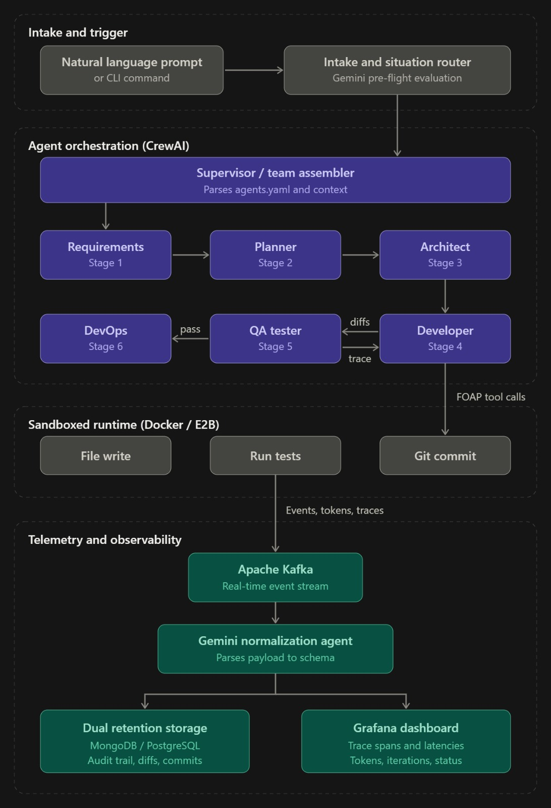

# FORGE SPAN

**An Autonomous Multi-Agent SDLC Framework with Federated Observability**
By **Cloud EQ**.

Cloud EQ is the team. FORGE SPAN is the product. The technical identifier remains
`CloudEQ`: the GitHub repository, the `cloudeq` package, and the `CLOUDEQ_`
environment prefix. See `docs/PROJECT_IDENTITY.md`.

Grok is the coding assistant in Cursor. Gemini is the application's runtime model
provider. This project does not replace Gemini with Grok.

## Setup status

Configuration is in place: requirements, contracts, environment names, Python
packaging, and a project-local development environment. Application routes,
agents, containers, brokers, databases, and dashboards are not implemented.
No live Gemini call is made by this repository.

Open this folder in Cursor, or open `FORGE-SPAN.code-workspace`. The always-applied
rule is `.cursor/rules/cloudeq.mdc`. `.cursorrules` carries the same guidance.
Keep their rule bodies synchronized.

The next session is Plane 1. Use `docs/CURSOR_START_PROMPT.md`. Do not start from
`docs/CURSOR_BUILD_PROMPT.md` unless the task is the full five-milestone build.

## Workspace structure

```text
.
|-- FORGE-SPAN.code-workspace
|-- CloudEQ.code-workspace
|-- pyproject.toml
|-- uv.lock
|-- .python-version
|-- .cursor/rules/cloudeq.mdc
|-- .cursorrules
|-- .gitignore
|-- .env.example
|-- README.md
|-- CONTRIBUTING.md
|-- docs/
|   |-- requirements.md
|   |-- implementation-status.md
|   |-- PROJECT_IDENTITY.md
|   |-- CURSOR_CONFIGURE_PROMPT.md
|   |-- CURSOR_START_PROMPT.md
|   |-- CURSOR_BUILD_PROMPT.md
|   |-- architecture/
|   |   |-- overview.md
|   |   |-- decisions.md
|   |   `-- contracts.md
|   `-- references/
|-- src/cloudeq/
|   |-- shared/
|   |   |-- contracts/
|   |   `-- ports/
|   |-- plane1_intake/
|   |-- plane2_agents/
|   |-- plane3_runtime/
|   `-- plane4_observability/
|-- infra/
|-- tests/
`-- scripts/
```

`src/cloudeq` packages contain markers only. `tests/` has no test modules yet.
`.env.example` has empty secrets and offline defaults. Do not commit `.env`.

## References in Cursor

Add these files to chat context before an implementation session:

- `docs/references/CloudEQ.extracted.md`
- `docs/references/FOAP-paper.extracted.md`
- `docs/references/FORGE-SPAN-architecture.md`
- `docs/references/FORGE-SPAN-architecture.jpg`
- the prompt for that session (`docs/CURSOR_START_PROMPT.md` for Plane 1)

Keep the original PDFs beside the extracts. The PDFs are authoritative. Extracts
are page-marked text, and figures may be missing from them. No assignment rubric
has been supplied. Never attach `.env` or API credentials.



Read `docs/references/README.md` before treating a sentence as a requirement.
`docs/requirements.md` records page references and planned checks.
`docs/architecture/contracts.md` records plane boundaries. The diagram's Git
commit box does not authorize a host commit or a push.

## Windows PowerShell setup

Run these commands from the repository root. The root must be this folder, not
`C:\Users\kaust\projects`.

```powershell
Set-Location C:\Users\kaust\projects\CloudEQ
git rev-parse --show-toplevel
py -3.12 --version
uv --version
uv sync
uv lock --check
uv run python -c "import cloudeq.plane1_intake, cloudeq.plane2_agents, cloudeq.plane3_runtime, cloudeq.plane4_observability, cloudeq.shared.contracts, cloudeq.shared.ports; print('imports-ok')"
uv run ruff check src tests
uv run ruff format --check src tests
uv run mypy
uv run pytest
```

`uv sync` creates `.venv` in this folder and installs the package plus pytest,
Ruff, and mypy. It does not install FastAPI, CrewAI, Kafka, MongoDB, Docker, or
Grafana, and it does not call Gemini.

Expected configuration results:

- `git rev-parse --show-toplevel` prints `C:/Users/kaust/projects/CloudEQ`.
- Python is 3.12.x and below 3.14. This machine used 3.12.2.
- `imports-ok` prints after the import command.
- Ruff and mypy exit 0 while the packages stay empty of application code.
- `uv run pytest` exits 5 and reports no tests collected. That is expected.
  It is not evidence that FORGE SPAN behaves correctly.

If `uv` is missing, install it from [Astral's uv documentation](https://docs.astral.sh/uv/getting-started/installation/) and open a new shell. If `py -3.12` fails, install CPython 3.12. The project rejects 3.14 because current CrewAI does not support it. Library versions and that constraint are in `docs/architecture/decisions.md`.

Copy `.env.example` to `.env` only when a later session needs local settings.
Leave secrets empty and leave `CLOUDEQ_GEMINI_LIVE_CALLS=false` until model IDs
are chosen deliberately.

## Roadmap

Status and the ordered plane plan are in `docs/implementation-status.md`.

1. Configuration — this repository state.
2. Plane 1, intake — next session.
3. Plane 2, agent orchestration.
4. Plane 3, sandboxed execution.
5. Plane 4, observability.
6. Integration and demonstration.

## GitHub and team contribution

The private repository is [kaustubhchaudhari11/CloudEQ](https://github.com/kaustubhchaudhari11/CloudEQ).
This folder is its own Git repository on a configuration branch until that work
is reviewed. It is independent of any repository in the parent directory. See
`CONTRIBUTING.md`. A pull-request template is under `.github/`.

Do not rename the GitHub repository to match the product name.
